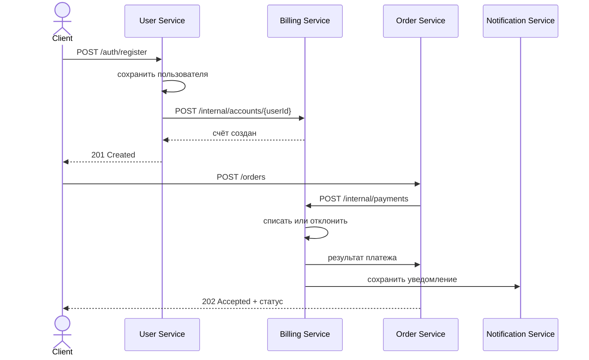
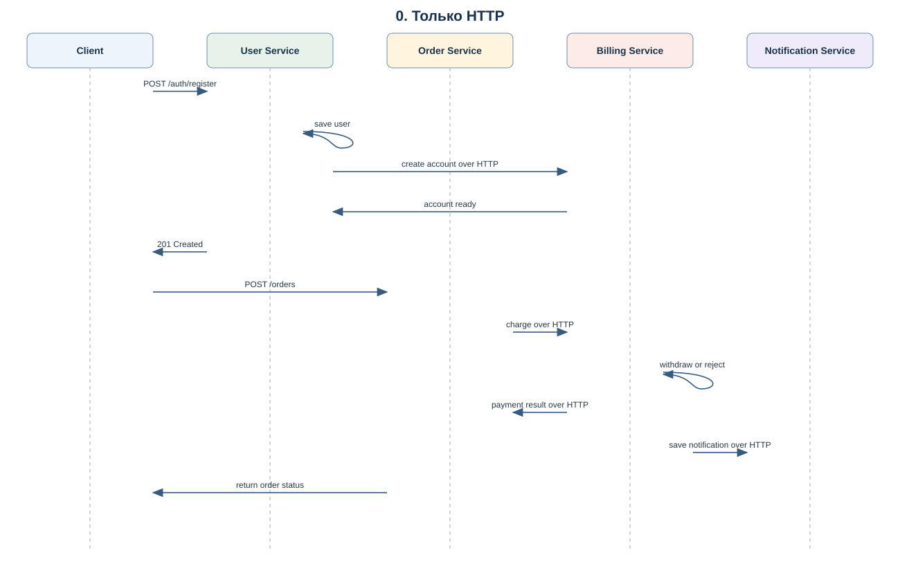
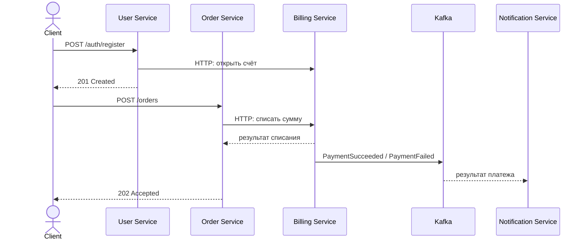
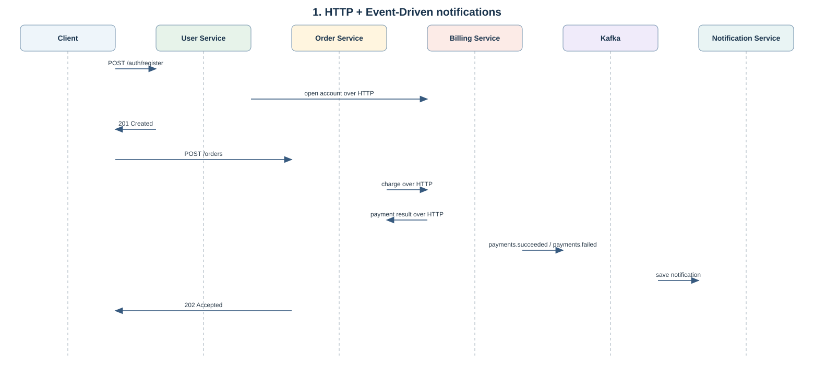
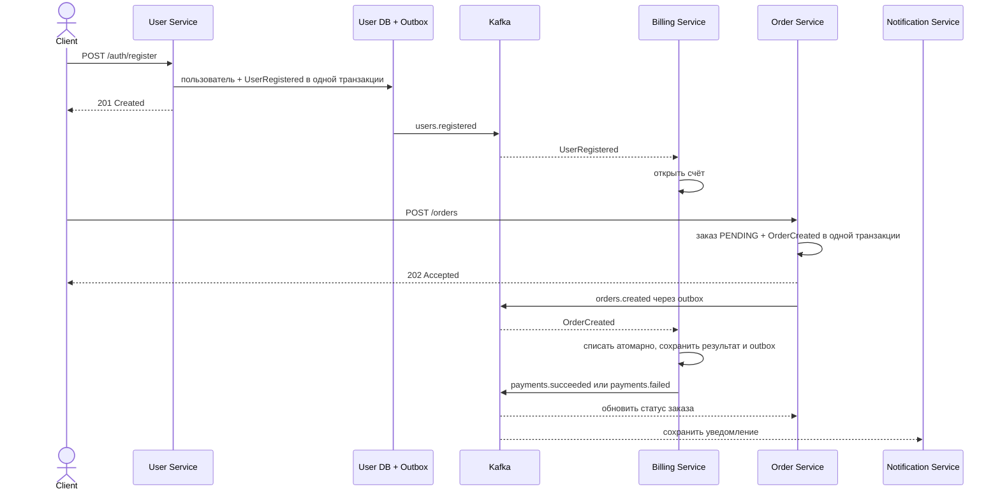
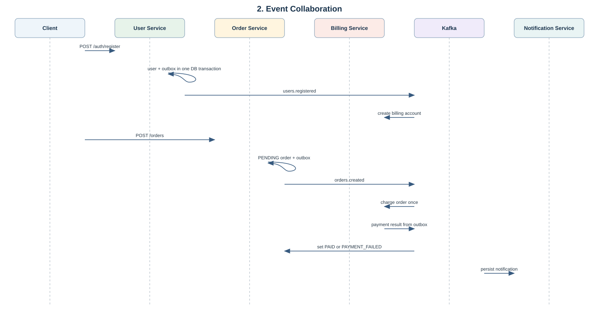
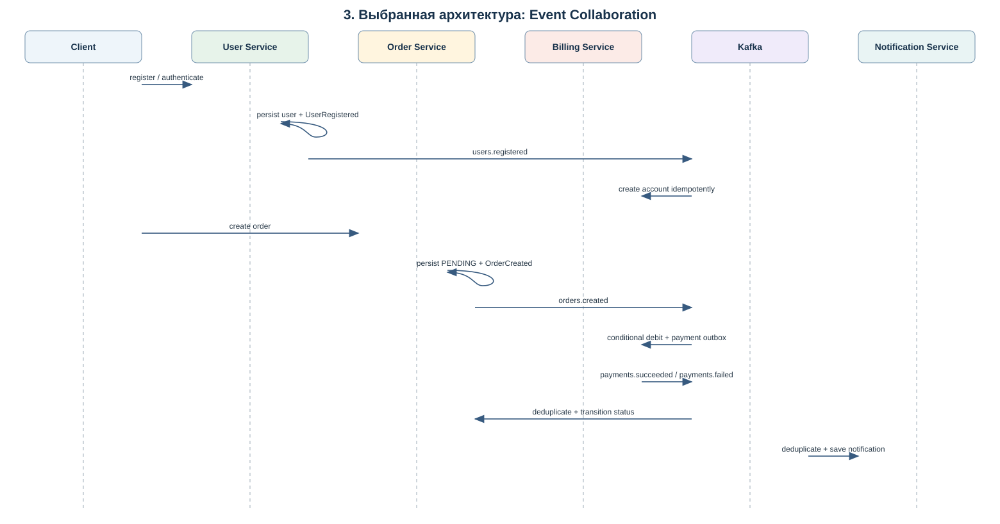

# OTUS Stream Processing: архитектурные варианты

Выбран вариант **3 — Event Collaboration**. Клиент вызывает сервисы по HTTP, а сервисы обмениваются результатами бизнес-операций через Kafka. Синхронных HTTP-вызовов между User, Billing, Order и Notification нет.

## 0. Только HTTP

User Service после сохранения пользователя синхронно вызывает Billing для открытия счёта. Order Service синхронно вызывает Billing для списания, а Billing синхронно вызывает Notification и Order для фиксации результата. Пользователь получает ответ после прохождения всей цепочки.



IDL такого варианта состоит из синхронных REST API. Черновой OpenAPI-контракт этого варианта:

```yaml
paths:
  /internal/accounts/{userId}:
    post:
      operationId: createAccount
      parameters: [{name: userId, in: path, required: true, schema: {type: integer, format: int64}}]
      responses: {'201': {description: Account created}}
  /internal/payments:
    post:
      operationId: chargeOrder
      requestBody:
        required: true
        content:
          application/json:
            schema:
              type: object
              required: [orderId, userId, email, amount]
              properties:
                orderId: {type: integer, format: int64}
                userId: {type: integer, format: int64}
                email: {type: string, format: email}
                amount: {type: number, multipleOf: 0.01}
      responses: {'200': {description: Payment status and optional reason}}
  /internal/orders/{id}/payment-result:
    patch: {operationId: updatePaymentStatus, responses: {'204': {description: Updated}}}
  /internal/notifications:
    post: {operationId: saveNotification, responses: {'201': {description: Saved}}}
```

Billing предоставляет `POST /internal/accounts/{userId}` и `POST /internal/payments`; Order предоставляет `POST /orders` и `PATCH /internal/orders/{id}/payment-result`; Notification предоставляет `POST /internal/notifications`. Kafka topics отсутствуют. В текущую реализацию эти внутренние endpoints намеренно не добавлены.



## 1. HTTP + Event-Driven для уведомлений

HTTP-команды создают пользователей и заказы, Order синхронно просит Billing выполнить списание, а Billing публикует результат платежа в Kafka. Order обновляет статус по событию, Notification сохраняет его независимо. Внешняя операция списания всё ещё зависит от доступности Billing.



REST IDL оставляет синхронные команды открытия счёта и списания:

```yaml
openapi: 3.1.0
paths:
  /internal/accounts/{userId}: {post: {operationId: createAccount}}
  /internal/payments: {post: {operationId: chargeOrder}}
```

Событийный IDL для уведомлений выглядит так:

```yaml
channels:
  payments.succeeded:
    publish:
      message:
        name: PaymentSucceeded
        payload: {eventId: string, occurredAt: date-time, orderId: int64, userId: int64, email: email, amount: number}
  payments.failed:
    publish:
      message:
        name: PaymentFailed
        payload: {eventId: string, occurredAt: date-time, orderId: int64, userId: int64, email: email, amount: number, reason: string}
```

Notification подписана на оба канала; Order изменяет статус из HTTP-ответа Billing. Этот вариант убирает HTTP-вызов для уведомлений, но сохраняет синхронную связь Order → Billing.



## 2. Event Collaboration

Каждый сервис владеет своей базой и публикует событие о завершённом изменении. Billing создаёт счёт по `UserRegistered` и проводит платеж по `OrderCreated`. Order и Notification получают платежные результаты в отдельных consumer groups.



REST IDL содержит публичные API: `POST /auth/register`, `POST /auth/login`, `GET /billing/accounts/me`, `POST /billing/accounts/me/deposit`, `POST /orders`, `GET /orders/{id}`, `GET /notifications`. Их полные схемы находятся в [`openapi.yaml`](openapi.yaml). Событийный IDL включает `users.registered` (`UserRegistered`), `orders.created` (`OrderCreated`), `payments.succeeded` (`PaymentSucceeded`) и `payments.failed` (`PaymentFailed`); полные схемы находятся в [`asyncapi.yaml`](asyncapi.yaml). Изменение бизнес-данных и создание исходящего события атомарны благодаря transactional outbox.



## 3. Выбранная архитектура

Выбран Event Collaboration из-за независимости сервисов во время бизнес-команд и явного владения данными. HTTP остаётся на внешней границе. User Service кладёт `UserRegistered` в outbox при регистрации. Order Service создаёт `PENDING` заказ и кладёт `OrderCreated` в свой outbox. Billing блокирует строку счёта, проводит не более одной транзакции на `orderId`, а затем атомарно сохраняет платежный результат и событие в outbox. Order и Notification используют разные consumer groups.

Outbox publisher опрашивает PostgreSQL, отправляет Kafka record и выставляет `published_at` только после подтверждения Kafka. Ошибка сохраняет текст ошибки и время следующей попытки. Если Kafka подтвердила сообщение, а PostgreSQL-транзакция publisher затем откатилась, сообщение будет доставлено ещё раз; consumers дедуплицируют его по устойчивому бизнес-ключу.



### Topics

| Topic | Producer | Consumers |
|---|---|---|
| `users.registered` | User Service | Billing Service (`billing-service`) |
| `orders.created` | Order Service | Billing Service (`billing-service`) |
| `payments.succeeded` | Billing Service | Order Service (`order-service`), Notification Service (`notification-service`) |
| `payments.failed` | Billing Service | Order Service (`order-service`), Notification Service (`notification-service`) |

### Владение данными

- User Service хранит пользователей и собственный outbox.
- Billing Service хранит `accounts`, `transactions` и outbox.
- Order Service хранит `customer_orders`, `payment_events` и outbox.
- Notification Service хранит `notifications`.
- Между базами и сервисами нет внешних ключей. Billing transaction ссылается только на локальный Billing account.

### Идемпотентность и согласованность

- Billing уникально сохраняет `order_id` в `transactions`; `accounts.balance` ограничен снизу нулём и изменяется условным SQL UPDATE под блокировкой счёта.
- Order уникально сохраняет входящий `eventId` и меняет статус только из `PENDING`.
- Notification использует уникальный `event_id` и `ON CONFLICT DO NOTHING`.
- Kafka listeners повторяют необработанные записи с задержкой; запись, которую нельзя обработать, удерживает partition до исправления причины.
- Согласованность между сервисами eventual. Сразу после регистрации или создания заказа клиент может увидеть отсутствие счёта или статус `PENDING`.

### Подписи REST и событий

Выбранный REST IDL — OpenAPI 3.1 в [`openapi.yaml`](openapi.yaml). Kafka IDL — AsyncAPI 2.6 в [`asyncapi.yaml`](asyncapi.yaml). Денежные суммы представлены JSON number с точностью до двух знаков, а в Java и PostgreSQL — `BigDecimal` и `NUMERIC(19,2)`. Идентификаторы — `Long` / `int64`.

## Локальная разработка

Запуск всех модулей и инфраструктуры описан в корневом [README](../README.md). Для каждого сервиса можно использовать отдельную PostgreSQL database на локальном PostgreSQL; K8s-манифесты создают `billing`, `orders`, `notifications` отдельно от `users`.
